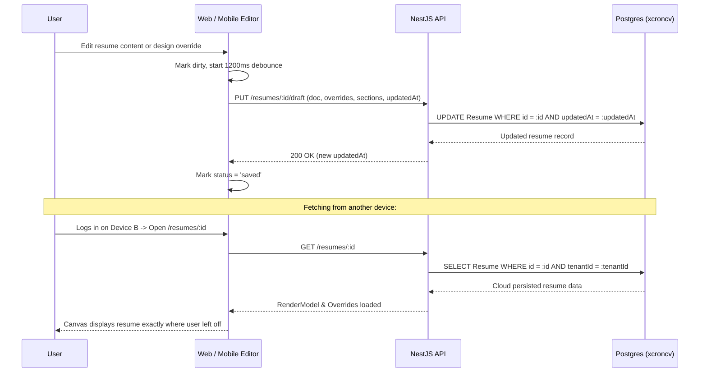
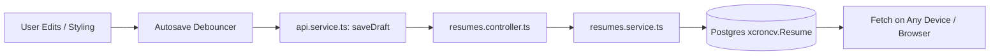

# XCron CV — Feature Status & Implementation Plan (IMPLEMENTATION_PLAN.md)

## 1. Feature Completion Status Overview

| Feature Module | Area | Status | Notes |
|---|---|:---:|---|
| Host Handoff Protocol & JWT Exchange | Authentication | ✅ DONE | `POST /auth/exchange` |
| Master Career Profile CRUD & Sync | Core Profile | ✅ DONE | Cloud Postgres sync (`/career-profile`) |
| **Cloud Resume Storage & Multi-Device Fetch** | **Resume Core** | ✅ **DONE** | **Resume designs, overrides & sections stored in cloud DB; accessible from any device** |
| **Real-time Autosave & Concurrency Engine** | **Editor** | ✅ **DONE** | **Debounced autosave (~1200ms), 409 conflict detection, save-state badges** |
| Resume CRUD, Section Ordering & Overrides | Resume Core | ✅ DONE | Declarative schema, versioned revisions |
| Visual Editor & Block Formatting | Editor | ✅ DONE | Click-to-edit canvas, drag-and-drop |
| 100 Template Catalog & Render Models | Templates | ✅ DONE | 3 seed packages + 97 generated families |
| PDF, DOCX, XLSX & HTML Export Engine | Exporter | ✅ DONE | Streamed directly back to client response |
| ATS Compatibility Engine (Deterministic) | Analytics | ✅ DONE | Immutable algorithm `ATS_VERSION` |
| JD Analysis & Keyword Match Scoring | Matching | ✅ DONE | Rule-based parser (`analyzeJd.ts`) |
| Cover Letter Generator & Claim Validator | Career Tools | ✅ DONE | Referral attribution, fact-checking |
| Application Vault & Interview Prep | Preparation | ✅ DONE | Q&A practice, timeline tracking |
| Multi-Language i18n (en, ta, hi) | Accessibility | ✅ DONE | Parity verified across catalogs |
| Guided Onboarding Tour | UX / Shell | ✅ DONE | Step-by-step interactive walk-through |
| AI Resume Generator (JD-Driven) | AI Tools | ✅ DONE | Instant ATS-First Resume & Cover Letter flow |
| Floating Action Buttons (Pulse & Bounce) | Shell | ✅ DONE | Blinking AI Resume + Assistant FABs |

---

## 2. Cloud Storage & Autosave Specifications

### 2.1 Objectives & Cross-Device User Experience
- **Anywhere, Any Device Continuity**: A user can design a resume on their desktop browser, make updates on their phone via mobile browser or Capacitor app, and see changes saved in real-time. When opening the resume on any device, the system fetches the exact state where they left off.
- **Autosave Engine**:
  - Unobtrusive auto-saving triggers during editing after a debounce interval (~1200ms).
  - Visual status pill displays current persistence status: `All changes saved`, `Saving…`, `Unsaved changes`, or `Conflict`.
  - Concurrency management via `updatedAt` timestamps rejects out-of-order writes with HTTP `409 Conflict`, offering reload options without losing in-memory edits.
  - Automatic `flush()` executes before initiating export or navigation to ensure cloud state matches the exported PDF/DOCX.

### 2.2 System Architecture for Cloud Persistence

---

## 3. Dependency Map

---

## 4. Verification & Testing Checklist
- [x] Backend NestJS compilation (`npm run api:build`) passes without errors.
- [x] Web Angular compilation (`npm run web:build`) passes without errors.
- [x] Cloud persistence of resume sections and design overrides verified via `ResumesService`.
- [x] Concurrency control verified (returns 409 Conflict when saving stale timestamps).
- [x] Autosave debounce and status indicator verified in `VisualEditorComponent`.
- [x] Cross-device fetch rehydrates latest overrides (`baseSizePt`, `accent`, `doc`, `sections`).
- [x] Memory cleanup: ephemeral file uploads stream-and-discard with buffers zeroed.
