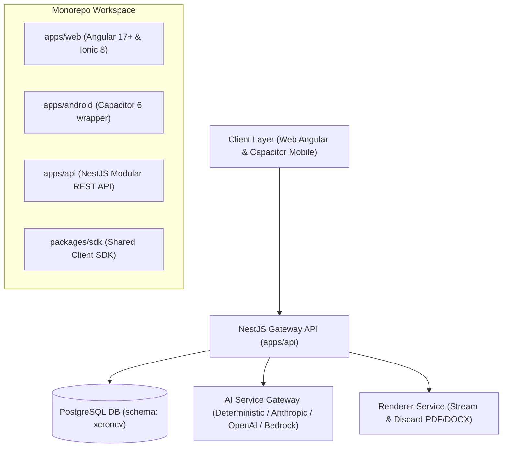

# XCron CV — System Architecture & Technical Decisions (PROJECT_CONTEXT.md)

## 1. Executive Summary

**XCron CV** is an independent, authenticated career-tools and resume-building platform microservice. While originating as a companion ecosystem to **X Cron**, XCron CV maintains complete architectural independence:
- Isolated repository, independent Postgres database (isolated in the `xcroncv` schema).
- Zero direct coupling with the X Cron host application internals.
- Stateless handoff via signed JWT tokens exchanged through the authenticated exchange protocol (`POST /auth/exchange`).
- Ephemeral, privacy-first processing: user export files and uploaded source documents are never permanently held on server disks.
- **Cloud-Based Resume & Profile Storage**: Complete resume configurations, visual customizations, layout styles, and profile entities are saved in the cloud database. Any user logging in from any desktop or mobile device seamlessly fetches their designed resumes and picks up exactly where they left off.

---

## 2. Technical Stack & Monorepo Topology

### 2.1 Workspace Structure
- **Frontend (`apps/web`)**: Angular 17+ utilizing standalone components, Angular signals for reactive state, OnPush change detection, and Ionic 8 standalone UI components for seamless cross-platform mobile/desktop usability.
- **Mobile (`apps/android`)**: Capacitor 6 wrapper serving the production-built Angular SPA with Android native navigation, safe area insets, and offline-resilient local filesystem storage.
- **Backend (`apps/api`)**: NestJS modular application with dependency injection, class-validator request DTOs, Throttler rate limiting, and Prisma ORM client.
- **Shared SDK (`packages/sdk`)**: TypeScript client bindings and webhook verification utilities.

---

## 3. Core Architectural Decisions

### 3.1 Cloud-Based Resume Storage & Autosave Engine
- **Cross-Device Continuity**: Resumes and profiles are first-class cloud entities stored in the `xcroncv` Postgres schema (`CareerProfile`, `Resume`, `ResumeVersion`).
- **Autosave Implementation**:
  - The visual editor watches user modifications (text, styling overrides, section ordering) and triggers debounced autosaves (1200ms debounce interval) to `PUT /resumes/:id/draft`.
  - Concurrency protection: Sends `If-Match` timestamp checks (`updatedAt`). On conflict, a `409 Conflict` is returned to prevent silent overwrites from concurrent devices.
  - Flush on exit: Navigation events and export triggers automatically invoke `flush()`, committing unsaved edits before page transitions.
- **Seamless Rehydration**:
  - Whenever a user opens `/resumes/:id` or `/profile` on any browser, laptop, tablet, or smartphone, the latest cloud-persisted state is fetched and loaded into the canvas.

### 3.2 Stream-and-Discard File Processing (No Server File Storage)
- **Constraint**: Candidate privacy and compliance regulations forbid storing raw resumes, parsed documents, or job description uploads on remote disks or databases.
- **Implementation**: Incoming PDF/DOCX streams are parsed directly in-memory via `extractPdf` (pdf-parse) and `extractDocx` (mammoth). Immediately upon extraction or error, buffers are zero-filled (`buf.fill(0)`).
- **Exporting**: Rendered PDF, DOCX, and XLSX payloads are generated on demand via shared render models (`src/render-model`) and streamed back over HTTP with `Cache-Control: no-store`.

### 3.3 Tenant Isolation and Deny-by-Default Security
- All incoming requests must bear an authenticated JWT token validated by `AuthGuard`.
- The identity tuple `{ tenantId, userId }` is decoded directly from the cryptographically verified JWT payload and injected via the `@CurrentUser()` decorator.
- Every Prisma query strictly applies `where: { tenantId: user.tenantId, userId: user.userId }` or links through the user's `profileId`. Multi-tenant leaks are physically impossible at the ORM layer.

### 3.4 Versioned, Deterministic Scoring vs. Suggestion-Only AI
- **Scoring Separation**: ATS compatibility scores, match percentages, resume quality checks, and text extraction confidence scores are computed by deterministic, rule-based algorithms with immutable versions (e.g., `SCORING_VERSION = 1.0.0`).
- **AI Policy**: AI services are strictly suggestion-only, gated behind explicit user opt-in (`aiSetting.enabled = true`). AI never decides scores, never automatically updates profile data without review, and automatically redacts PII before external provider dispatch.

---

## 4. Key Feature Map & Module Matrix

| Feature Area | Module / Path | Technical Highlights |
|---|---|---|
| **Cloud Resume Storage & Autosave** | `apps/api/src/resumes`, `apps/web/.../visual-editor` | Real-time debounced autosave, optimistic concurrency checks, cross-device resume rehydration |
| **Career Profile Sync** | `apps/api/src/career-profile`, `apps/web/src/app/pages/profile` | Master profile CRUD, multi-section sync (experience, skills, education, projects) |
| **AI Resume Generator** | `apps/api/src/jd-resume-generator` | Stateless JD analysis, auto-selection of ATS-First templates, tailored summary synthesis |
| **Resume Editor & Visual Designer** | `apps/web/src/app/pages/resume-editor` | Drag-and-drop section reordering, real-time font/color tokens, paper-size calibration (A4/Letter) |
| **JD Match & Gap Analysis** | `apps/api/src/resume-match` | Rule-based JD parser (`analyzeJd`), keyword taxonomy, evidence citation |
| **Cover Letter Generator** | `apps/api/src/cover-letters` | Fact verification, tone adjustment, version snapshots, referral attribution |
| **Template Catalog** | `apps/api/src/templates` | 100 immutable templates (3 seed + 97 procedural families), declarative layouts |
| **AI Chatbot & Assistant** | `apps/api/src/ai` | Quota-governed, prompt-injection defense, fallback to deterministic engine |

---

## 5. UI/UX Design System & Tokens

XCron CV employs a refined design token system defined in `apps/web/src/styles.scss`:
- **Palette**: Violet primary (`--c-primary: #6d4ff0`), Amber accent (`--c-accent: #f5a524`), and High-Energy Brand Gradient (`linear-gradient(90deg, #7c5cff 0%, #f5a524 100%)`).
- **Dark Mode**: Automatically respects OS preference and user selection via `data-theme="dark"` attribute on `<html>`.
- **Responsive Layout**: Desktop features a persistent navigation rail (`--nav-w: 14rem`), while mobile displays an ergonomic bottom navigation bar that cleanly hides during editor-immersive workflows.
- **Floating Action Buttons**:
  - **AI Resume Generator FAB**: Floating button at bottom-right with continuous glowing pulse animation (`fab-pulse`), direct access to `/ai-resume-generator`.
  - **AI Chatbot FAB**: Floating button stacked below with subtle idle bounce (`fab-bounce`), direct access to `/ai`.
